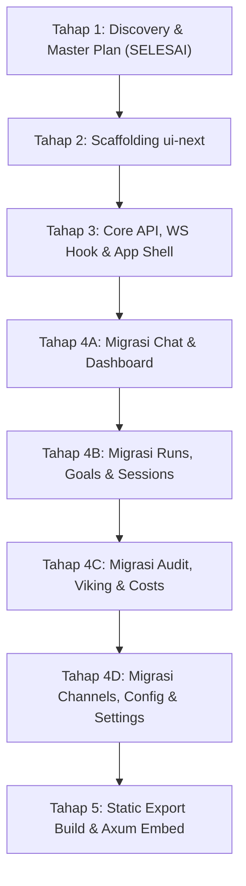

# AGY12 — Master Plan: Migrasi Frontend Ryvos ke Next.js Static Export

## Live Progress Log & Chat

> **Status Saat Ini**: `OVERHAUL UI/UX & SVELTE 5 PURGE SELESAI (SATU-SATUNYA FRONTEND RESMI: UI-NEXT)`  
> **Terakhir Diperbarui**: `2026-11-08 01:50:00 UTC`  
> **Penanggung Jawab**: AGY12 (Senior Frontend Specialist & Next.js Architect)  
> **Target Pengawas**: User & AGY01 (Lead Orchestrator)

### Catatan & Pesan Interaktif AGY12
- **[2026-11-08 01:50] Overhaul UI/UX & Penghapusan Svelte 5 (Tahap 6)**:
  - **Penghapusan Frontend Lama**: Direktori `crates/ryvos-gateway/ui-src/` dihapus permanen (`rm -rf`). `crates/ryvos-gateway/ui-next/` kini menjadi SATU-SATUNYA source code frontend resmi proyek ini.
  - **Unified Model Selector**: Mengganti combo dropdown + text input model ID lama di header chat dengan single trigger pill elegan: `[● Model Name ▾] [X Keys]`. Ketika diklik, membuka popover/modal terpadu dengan segmented provider tabs (Gemini, Claude, OpenAI, DeepSeek, Groq, Ollama), preset cards minimalis, opsi kustom model ID, dan Key Pool rotator terintegrasi.
  - **Anti-Slop Concise Microcopy**:
    - Placeholder textarea: `'Ketik prompt...'`.
    - Empty state chat: Minimalis & elegan dengan heading `'Ryvos AI'` dan subtext `'Mulai percakapan atau jalankan instruksi.'` tanpa wall of text.
    - Labels ringkas: `'Kirim'`, `'Stop'`, `'Baru'`, `'Salin'` (lengkap dengan clipboard feedback).
    - Merapikan dan meringkas seluruh teks di Dashboard, Sessions, Runs, Goals, dan Settings.
  - **Card UI & Visual Consistency**: Standar border halus `border-border/60`, subtle soft shadow, padding proporsional, dan ikon SVG murni tanpa emoji.
  - **Build & Verification**:
    - `npm run build` di `ui-next/` berhasil 100% mengekspor 17/17 rute statis ke `crates/ryvos-gateway/ui/`.
    - `cargo check -p ryvos-gateway -j 2` berhasil (`exit code 0`), memverifikasi embed Rust gateway berjalan sempurna.
- **[2026-11-08 00:25] Discovery Dimulai**: Melakukan deep inspection terhadap seluruh file di `crates/ryvos-gateway/ui-src/`, `crates/ryvos-gateway/src/routes.rs`, `crates/ryvos-gateway/src/server.rs`, dan `crates/ryvos-gateway/src/static_files.rs`.
- **[2026-11-08 00:30] Master Plan Tahap 1 Selesai**: Dokumen perencanaan lengkap (arsitektur, mapping REST API, protokol WebSocket, Neumorphism design system, dan roadmap eksekusi bertahap) telah diformulasikan secara presisi tanpa spekulasi/halusinasi.
- **[2026-11-08 00:34] Approval Diterima**: User & AGY01 memberikan approval penuh untuk eksekusi Next.js Static Export di `crates/ryvos-gateway/ui-next/`.
- **[2026-11-08 00:36] Scaffolding & Setup Dependencies (Tahap 2)**: Menginisialisasi `ui-next` (Next.js 15, React 19, Tailwind CSS 3, TypeScript 5, Marked 15, DOMPurify 3). Menyiapkan token Soft Blue Neumorphism (#2E56E0, dual soft shadows, radius hierarchy, WCAG 2.2 AA).
- **[2026-11-08 00:39] Core Infrastructure & App Shell (Tahap 3)**:
  - `lib/api.ts`: Modular REST wrapper dengan Bearer auth & auto-logout 401.
  - `lib/ws.ts`: WebSocket client singleton dengan auto-reconnect exponential backoff, request-response tracker (RPC), token stream accumulator, dan activity telemetry.
  - `lib/context.tsx`: Context provider terpadu untuk Auth, Theme (Light/Dark data-theme), dan WebSocket telemetry.
  - Layout Shell: `Shell.tsx`, `Sidebar.tsx`, `Header.tsx`, `MobileBottomNav.tsx`, `CommandPalette.tsx` (Ctrl+K), `LoginOverlay.tsx`.
- **[2026-11-08 00:43] Implementasi 13 Halaman (Tahap 4)**:
  - Batch 1: `Chat` (MarkdownView, ThinkingFold `<think>`, ToolCallCard, ApprovalCard, Multi-Key Pool modal), `Dashboard` (Cluster overview, live ActivityFeed, quick links).
  - Batch 2: `Sessions` (channel filter, turn count), `Runs` (history table, duration, token in/out, inspect modal), `Goals` (autonomous goal execution, max turns slider, judge model, verdict traces).
  - Batch 3: `Audit` (4 tabs: Security/SSRF, Safety Lessons, Decisions, Failures), `Costs` (token usage & expenditure tracker), `Viking` (OpenViking L0/L1/L2 memory browser & search).
  - Batch 4: `Channels` (Telegram, Discord, Slack, WhatsApp), `Integrations` (MCP server registry, transport stdio/sse), `Cron` (scheduled jobs, heartbeat history, skills graph), `Config` (runtime config.toml editor), `Settings` (budget limits, model rotator).
- **[2026-11-08 00:45] Static Export Build (Tahap 5)**:
  - Menjalankan `npm run build` di `crates/ryvos-gateway/ui-next/` (`output: 'export'`).
  - Hasil build 17/17 routes berhasil diekspor 100% murni statis ke `crates/ryvos-gateway/ui/` tanpa error TypeScript atau link error.
  - Memperbarui Axum backend di `crates/ryvos-gateway/src/static_files.rs` dan `crates/ryvos-gateway/src/server.rs` (`spa_fallback` dan handler `/_next/{*path}`).
- **[Pemberitahuan Invarian Terpenuhi]**:
  1. `crates/ryvos-gateway/ui-src/` 100% UTUH dan TIDAK DIHAPUS.
  2. Production delivery murni static tanpa Node.js runtime / npm start.
  3. Desain Soft Blue Neumorphism dan seluruh 13 halaman telah diimplementasikan secara komprehensif.

---

## 1. Executive Summary & Batasan Sistem

### 1.1 Visi Proyek
Membangun duplikasi/migrasi frontend Ryvos Control Plane menggunakan **Next.js (App Router, TypeScript, Tailwind CSS, Soft Blue Neumorphism)** yang berjalan dengan mode **Static Export (`output: 'export'`)**.
Frontend ini akan di-compile menjadi artefak statis murni (`index.html`, `_next/static/...`, assets) yang di-embed langsung ke dalam binary Rust `ryvos-gateway` via crate `rust-embed`. 

### 1.2 Strict Invariants
1. **Zero Node.js Runtime in Production**: Binary Rust didistribusikan sebagai single binary tanpa dependensi `npm start`, Node.js server, ataupun Vercel serverless runtime.
2. **Deprekasi & Penghapusan `ui-src/`**: Direktori Svelte 5 lama telah dihapus permanen, dan `crates/ryvos-gateway/ui-next/` resmi menjadi SATU-SATUNYA source code frontend proyek ini.
3. **Target Direktori Baru**: Seluruh kode Next.js berada di `crates/ryvos-gateway/ui-next/`.
4. **Target Output Static**: Hasil build Next.js diekspor ke direktori `crates/ryvos-gateway/ui/` (menggantikan dist lama secara seamless).
5. **Memory & VPS Ceiling**: Idle RAM Rust binary tetap 15–30 MB (<60 MB aktif), proses build Next.js dijalankan dengan resource aware agar tidak memicu OOM pada cgroup VPS (4 GB limit).
6. **Desain Anti-Slop (WCAG 2.2 AA)**: Mengikuti standar Neumorphism biru lembut (#2E56E0), kontras tinggi, zero generic AI sparkles, dan radius bertingkat.

---

## 2. Pemetaan Komprehensif Frontend Svelte 5 (`ui-src/`)

### 2.1 Modul REST API (`src/lib/api.js`)
Modul `api.js` mengelola token otentikasi di `localStorage` dan wrapper `apiFetch`:
- **Auth Key Storage**: `ryvos_api_key` disimpan di `localStorage`.
- **Header Injection**: `Authorization: Bearer <token>` otomatis disematkan pada setiap request jika key tersedia.
- **Auto-Logout 401**: Jika endpoint merespons status `401 Unauthorized`, key dihapus dan halaman di-reload ke login overlay.

#### Tabel Pemetaan Lengkap REST API Backend
| HTTP Method | Path Endpoint | Parameter / Payload | Dipanggil Oleh Halaman / Komponen | Keterangan & Tujuan |
| :--- | :--- | :--- | :--- | :--- |
| `GET` | `/api/health` | - | `Sidebar.svelte`, `Dashboard.svelte`, `Settings.svelte` | Memeriksa uptime cluster, health status, dan versi gateway. |
| `GET` | `/api/sessions` | - | `Chat.svelte`, `Sessions.svelte` | Mengambil daftar seluruh sesi percakapan agent. |
| `GET` | `/api/sessions/{id}/history` | `limit=100` | `Chat.svelte` | Mengambil riwayat pesan teks & metadata percakapan per sesi. |
| `POST` | `/api/sessions/{id}/messages` | `{ message, role }` | API Gateway Backend | Mengirim pesan manual via HTTP (opsional, webui utamanya via WS). |
| `GET` | `/api/metrics` | - | `Dashboard.svelte`, `Settings.svelte` | Telemetri runtime: turn count, token usage, memory, error rate. |
| `GET` | `/api/runs` | `limit=50&offset=0` | `Runs.svelte` | Riwayat eksekusi agen otonom beserta status, durasi, dan token. |
| `GET` | `/api/costs` | `from, to, group_by` | `Costs.svelte` | Agregasi biaya penggunaan LLM per model/provider/sesi. |
| `GET` | `/api/audit` | `limit, category` | `AuditTrail.svelte` | Log audit keamanan, pencegahan SSRF, pemblokiran tool. |
| `GET` | `/api/audit/stats` | - | `Dashboard.svelte`, `AuditTrail.svelte` | Statistik ringkas kejadian keamanan dan pelanggaran guardrail. |
| `GET` | `/api/safety/lessons` | - | `AuditTrail.svelte` | Database aturan dan pelajaran keamanan adaptif yang dipelajari runtime. |
| `GET` | `/api/decisions` | `limit=50` | `AuditTrail.svelte` | Log penalaran dan keputusan trade-off strategi oleh runtime agen. |
| `GET` | `/api/failures` | - | `AuditTrail.svelte` | Jurnal kegagalan eksekusi dan tindakan mitigasi/pemulihan runtime. |
| `GET` | `/api/viking/list` | `path=<url-encoded>` | `VikingBrowser.svelte` | Navigasi hirarkis pohon direktori memori OpenViking. |
| `GET` | `/api/viking/read` | `path, level (L0/L1/L2)` | `VikingBrowser.svelte` | Membaca konten memori hierarkis (L0 abstrak, L1 konteks, L2 mentah). |
| `GET` | `/api/viking/search` | `q=<query>` | `VikingBrowser.svelte` | Pencarian semantik dan kata kunci dalam memori Viking. |
| `GET`/`PUT` | `/api/config` | JSON config toml | `ConfigEditor.svelte`, `Integrations.svelte` | Membaca dan memperbarui konfigurasi `config.toml` runtime. |
| `GET` | `/api/channels` | - | `Channels.svelte` | Status koneksi adapter eksternal (Telegram, Discord, Slack, WhatsApp). |
| `GET` | `/api/approvals` | - | `Chat.svelte` | Daftar tool execution yang meminta approval manusia (HITL). |
| `POST` | `/api/approvals/{id}/approve` | - | `Chat.svelte` | Menyetujui eksekusi tool berisiko (shell command, file write). |
| `POST` | `/api/approvals/{id}/deny` | - | `Chat.svelte` | Menolak eksekusi tool berisiko. |
| `GET`/`POST`| `/api/cron` | `{ name, expr, prompt }` | `Graph.svelte` | Membaca daftar dan mendaftarkan jadwal cron job otonom. |
| `DELETE` | `/api/cron/{name}` | - | `Graph.svelte` | Menghapus jadwal cron job yang sedang aktif. |
| `GET`/`PUT` | `/api/budget` | `{ daily_limit, ... }` | `Settings.svelte` | Membaca dan mengatur ambang batas budget token dan proteksi OOM. |
| `GET`/`PUT` | `/api/model` | `{ provider, model_id, api_keys }` | `Chat.svelte`, `Settings.svelte` | Mengambil & mengubah provider/model aktif serta rotasi multi-key pool. |
| `GET` | `/api/models/available` | - | `Settings.svelte` | Daftar model yang didukung oleh cluster. |
| `GET` | `/api/integrations` | - | `Integrations.svelte` | Status integrasi MCP server, GitHub, database, dll. |
| `POST` | `/api/integrations/{app}/connect` | `{ config }` | `Integrations.svelte` | Mengaktifkan dan menghubungkan integrasi tool/server baru. |
| `DELETE` | `/api/integrations/{app}` | - | `Integrations.svelte` | Memutuskan integrasi tool. |
| `GET` | `/api/skills` | - | `Settings.svelte`, `Graph.svelte` | Daftar skill dinamis yang terdeteksi dalam runtime. |
| `GET` | `/api/heartbeat/history` | - | `Graph.svelte` | Riwayat log interval heartbeat monitoring agen. |
| `POST` | `/api/goals/run` | `{ prompt, max_turns, judge }` | `Goals.svelte` | Menjalankan misi otonom berorientasi tujuan (Autonomous Goals). |
| `GET` | `/api/goals/history` | - | `Goals.svelte` | Riwayat evaluasi tujuan otonom, skor verifikasi, dan trace langkah. |

---

### 2.2 Protokol WebSocket (`src/lib/ws.js` & `crates/ryvos-gateway/src/protocol.rs`)
Koneksi WebSocket duplex dibuka ke `/ws?token=<token>`.

#### 1. Struktur Frame Klien (`type: "request"`)
```json
{
  "type": "request",
  "id": "1",
  "method": "agent.send",
  "params": {
    "session_id": "webui:abc123xyz",
    "message": "Analisis file Cargo.toml",
    "provider": "gemini",
    "model_id": "gemini-3.6-flash"
  }
}
```

#### 2. Metode JSON-RPC Klien yang Didukung
- `agent.send`: Mengirim prompt pengguna untuk dieksekusi oleh loop runtime agen.
- `agent.cancel`: Membatalkan run yang sedang berjalan (`runtime.cancel_active_run()`).
- `model.get`: Mengambil metadata provider aktif, model ID, dan jumlah key pool.
- `model.set`: Mengatur provider, model ID, dan daftar API keys untuk rotasi pool.
- `session.create`: Menginisiasi sesi baru.
- `session.list`: Mengambil daftar sesi aktif via WebSocket.
- `session.history`: Mengambil riwayat pesan percakapan via WebSocket.
- `approval.respond`: Mengirim respons approve/deny terhadap tool call.

#### 3. Struktur Frame Respons Server (`type: "response"`)
```json
{
  "type": "response",
  "id": "1",
  "result": { "response": "Hasil analisis..." },
  "error": null
}
```

#### 4. Event Streaming Real-time (`type: "event"`)
Server mendorong event asinkron ke klien:
```json
{
  "type": "event",
  "session_id": "webui:abc123xyz",
  "event": {
    "kind": "text_delta",
    "text": "..."
  }
}
```
**Daftar 17 Event Kind & Penanganan di UI:**
1. `text_delta`: Token streaming parsial dari LLM. Diakumulasi ke `streamingText`.
2. `run_started`: Run ID dimulai, inisialisasi state running di UI.
3. `run_complete`: Run selesai. Menerima `total_turns`, `input_tokens`, `output_tokens`. Menutup kursor streaming dan mematikan tombol cancel.
4. `run_error`: Kesalahan eksekusi agen. Menampilkan pesan error berwarna merah.
5. `tool_start`: Agen memanggil tool eksternal (misal `read_file`, `bash`). Menambahkan kartu collapsible Tool Call dengan status `running`.
6. `tool_end`: Pemanggilan tool selesai. Memperbarui kartu tool call dengan output dan durasi eksekusi (`elapsed ms`).
7. `usage_update`: Peningkatan pemakaian token delta (`input_tokens`, `output_tokens`).
8. `budget_warning`: Ambang peringatan budget tercapai (misal 80%). Menampilkan banner kuning di telemetry feed.
9. `budget_exceeded`: Budget token terlampaui. Eksekusi dihentikan.
10. `heartbeat_fired`: Heartbeat health ping terpicu.
11. `heartbeat_ok`: Heartbeat sukses merespons.
12. `heartbeat_alert`: Heartbeat mendeteksi anomali pada runtime.
13. `cron_fired`: Jadwal cron job dijalankan.
14. `cron_complete`: Jadwal cron job selesai.
15. `guardian_stall`: Loop guardian mendeteksi stall (agen berhenti merespons tanpa terminasi).
16. `guardian_doom_loop`: Loop guardian mendeteksi pengulangan aksi tak berujung (doom loop) dan memicu intervensi.
17. `approval_requested`: Pemanggilan tool berbahaya memerlukan persetujuan operator manusia (HITL). Menampilkan kartu interaktif dengan tombol **Approve** dan **Deny**.

---

### 2.3 State Global Svelte 5 (`src/lib/stores.js` & `src/lib/ws.js`)
- `authenticated` (`writable(boolean)`): Menyimpan status apakah user telah memasukkan token autentikasi yang valid.
- `connectionStatus` (`writable('connected' | 'disconnected' | 'error')`): Status koneksi WebSocket real-time.
- `currentModelInfo` (`writable({ provider, model_id, key_count })`): Metadata model LLM aktif.
- `activityFeed` (`writable(Array<EventEntry>)`): Buffer 100 event terakhir untuk telemetry feed real-time.
- `streamingText` (`writable(string)`): Buffer teks streaming aktif dari event `text_delta`.

---

### 2.4 Bedah Komponen Antarmuka (`src/lib/components/`)
1. **`Sidebar.svelte` (169 baris)**:
   - Menampilkan logo Ryvos, brand title, dan badge versi (`v0.9.0`).
   - 13 link navigasi dengan active highlight neumorphic soft-blue (`bg-[var(--color-primary-soft)] text-[var(--color-primary)] font-bold`).
   - Status koneksi realtime (dot hijau/kuning/merah) dan tombol **Disconnect** (logout).
   - Drawer responsif pada mobile dengan backdrop overlay transparan.
2. **`CommandPalette.svelte` (129 baris)**:
   - Modal pencarian cepat (shortcut `Ctrl+K` atau `Cmd+K`).
   - Fuzzy filter terhadap 13 rute halaman beserta deskripsi singkat fungsinya.
   - Navigasi keyboard (`ArrowUp`, `ArrowDown`, `Enter`, `Escape`).
3. **`LoginOverlay.svelte` (65 baris)**:
   - Layar modal autentikasi saat `authenticated === false`.
   - Input password/token gateway dengan placeholder `rk_...` dan tombol submit "Connect to Control Plane".
   - Opsi blank login jika cluster tidak mengaktifkan auth.
4. **`ActivityFeed.svelte` (55 baris)**:
   - Panel telemetry stream aktivitas langsung.
   - Menampilkan timestamp tabular, status dot indikator, detail event (tool call, cron, stall alert), dan tag session ID.
5. **`MetricCard.svelte` (20 baris)**:
   - Kartu statistik berulang dengan label uppercase, angka tabular-nums besar, deskripsi opsional, dan ikon SVG neumorphic.
6. **`MobileBottomNav.svelte` (53 baris)**:
   - Navigasi bawah fixed khusus perangkat mobile (`md:hidden`).
   - Akses instan ke 5 rute primer: Chat, Dashboard, Runs, Goals, Settings.

---

### 2.5 Bedah 13 Halaman Aplikasi (`src/lib/pages/`)
1. **`Chat.svelte` (783 baris)**:
   - Header interaktif: selector provider (Gemini, Anthropic, OpenAI, DeepSeek, Groq, OpenRouter, Ollama) dan model presets.
   - Modal konfigurasi Multi-Key Pool Rotator (`api_keys` pool untuk mencegah rate-limit).
   - Panel riwayat sesi samping dengan fitur pencarian dan tombol **New Chat**.
   - Render pesan User dengan background primary gradient biru.
   - Render pesan Assistant dengan parser Markdown terproteksi sanitasi (`marked` + `DOMPurify`).
   - Kartu Tool Call interaktif: dapat di-expand untuk melihat input payload dan output hasil tool.
   - Kartu Human-in-the-Loop (HITL) Approval: tombol Approve & Deny langsung ke endpoint `/api/approvals/{id}/...`.
   - Streaming kursor berkedip (`.streaming-cursor`).
   - Textarea input pesan dengan autosize, tombol Send, dan tombol **Stop** (cancel run).
2. **`Dashboard.svelte` (310 baris)**:
   - Ringkasan metrik utama: Status Cluster, Total Sessions, Total Runs, Biaya & Budget.
   - Telemetry Activity Stream real-time terintegrasi.
   - Tautan Quick Action ke fitur-fitur krusial.
3. **`Sessions.svelte` (124 baris)**:
   - Tabel seluruh percakapan aktif dengan filter channel (webui, telegram, discord).
   - Jumlah interaksi pesan dan tombol direct jump ke chat view.
4. **`Runs.svelte` (190 baris)**:
   - Log eksekusi historis agen otonom.
   - Kolom status (completed, running, failed), durasi waktu, turn count, dan rincian konsumsi token in/out.
   - Pagination server-side (`limit` & `offset`).
5. **`Goals.svelte` (305 lines)**:
   - Antarmuka Autonomous Goal Execution: input instruksi misi tingkat tinggi, slider batas maksimal turn, dan pemilihan model evaluator/judge.
   - Panel riwayat misi dengan status evaluasi (SUCCESS / FAILURE), skor kritik, dan log jejak investigasi per langkah.
6. **`AuditTrail.svelte` (477 baris)**:
   - 4 Tab Observabilitas Keamanan:
     1. *Security Events*: Log audit pembatasan SSRF egress dan pemblokiran tool.
     2. *Safety Lessons*: Aturan keamanan adaptif yang dipelajari runtime dari kesalahan sebelumnya.
     3. *Autonomous Decisions*: Rekam jejak pengambilan keputusan agen dan justifikasi strategis.
     4. *Failure Journal*: Analisis akar penyebab kegagalan runtime dan riwayat auto-recovery.
7. **`Costs.svelte` (184 baris)**:
   - Pelacakan biaya API LLM berdasarkan rentang waktu (24 jam, 7 hari, 30 hari) dan pengelompokan (Model, Provider, Session).
   - Ringkasan total pengeluaran ($) dan estimasi per run.
8. **`Integrations.svelte` (315 baris)**:
   - Manajemen server MCP (Model Context Protocol) dan konektor tool eksternal (GitHub, Slack, PostgreSQL).
   - Modal konfigurasi parameter koneksi dan otentikasi.
9. **`Channels.svelte` (93 baris)**:
   - Status live adapter perpesanan pihak ketiga: Telegram Bot, Discord Gateway, Slack Webhook, WhatsApp Cloud API.
10. **`VikingBrowser.svelte` (252 baris)**:
    - Penjelajah memori hierarkis OpenViking: L0 (ringkasan abstrak), L1 (konteks operasional), L2 (teks sumber mentah).
    - Navigasi breadcrumbs folder memori dan fitur pencarian kata kunci/vektor.
11. **`Graph.svelte` (Cron & Telemetry) (376 baris)**:
    - Manajemen cron job berulang (pembuatan jadwal cron, ekspresi waktu, prompt pemicu, penghapusan jadwal).
    - Timeline log riwayat pemantauan heartbeat runtime.
    - Visualisasi ketergantungan skill agen terpasang.
12. **`ConfigEditor.svelte` (105 baris)**:
    - Editor teks konfigurasi `config.toml` dengan monospace font.
    - Validasi format dan tombol simpan langsung ke backend.
13. **`Settings.svelte` (496 baris)**:
    - Pengaturan batas budget harian token dan threshold peringatan.
    - Penggantian model default sistem dan rotasi key pool.
    - Informasi diagnostik sistem: versi binary, cgroup limit, arsitektur CPU, dan memory consumption.

---

### 2.6 Ekstraksi Standar Desain Soft Blue Neumorphism

Berdasarkan `DESIGN.md`, `src/app.css`, dan `tailwind.config.js`:
- **Dial Parameter**: `ENERGY 1` (tenang, profesional) / `RHYTHM 2` (teratur, konsisten) / `MOTION 1` (halus, minim distraksi, hormat prefers-reduced-motion).
- **Palet Warna Inti**:
  - Light Background: `#EDF1FC`
  - Light Surface: `#F4F6FF` (Surface Raised: `#FFFFFF`, Surface Inset: `#E6ECF9`)
  - Dark Background: `#0F1729`
  - Dark Surface: `#162038` (Surface Raised: `#1E2B4A`, Surface Inset: `#0B1120`)
  - Primary Accent: `#2448CB` (Strong: `#1D3AA8`, Soft: `#E4ECFF`)
  - Primary Gradient: `linear-gradient(135deg, #2E56E0 0%, #2448CB 55%, #1D3AA8 100%)`
  - WCAG 2.2 AA Compliance: Rasio kontras 5.96:1 antara teks putih dan tombol primary gradient.
- **Hierarki Shadow Neumorphic**:
  - Surface Raised: `6px 6px 14px rgba(182, 195, 220, 0.65), -6px -6px 14px rgba(255, 255, 255, 0.92)`
  - Surface Raised Small: `3px 3px 8px rgba(182, 195, 220, 0.55), -3px -3px 8px rgba(255, 255, 255, 0.88)`
  - Inset (Input & Search): `inset 2px 2px 6px rgba(180, 193, 218, 0.65), inset -2px -2px 6px rgba(255, 255, 255, 0.92)`
  - Floating (Modals): `0 12px 32px rgba(22, 35, 59, 0.14)`
- **Hierarki Border Radius**:
  - `radius-xs` (8px): Badge status & indikator kecil.
  - `radius-sm` (12px): Kotak input text, search bar, textarea.
  - `radius-md` (14px): Tombol interaktif (Button primary, soft, outline).
  - `radius-lg` (18px): Kartu metrik, panel data, kontainer tabel.
  - `radius-xl` (24px): Kartu fokal utama, dialog modal, panel navigasi sidebar.
  - `radius-pill` (9999px): Pill tabs, status chips.
- **Tipografi**:
  - Headings & Body: `"Plus Jakarta Sans", ui-sans-serif, system-ui, sans-serif`
  - Monospace (Code, Tabular numbers, Log): `"JetBrains Mono", ui-monospace, monospace`
- **Zero-Slop Rule**:
  - Dilarang keras menggunakan emoji informal dalam UI.
  - Ikon murni menggunakan rounded-stroke SVG 24x24 semantik (Lucide SVG style).
  - Blur backdrop transparan dibatasi hanya pada header sticky dan backdrop modal.

---

## 3. Rencana Arsitektur Next.js Static Export (`ui-next/`)

### 3.1 Struktur Direktori Proyek Next.js
Proyek baru akan diinisialisasi di `crates/ryvos-gateway/ui-next/`:
```text
crates/ryvos-gateway/ui-next/
├── app/
│   ├── layout.tsx              # Root HTML layout, font setup, ThemeProvider, ToastProvider
│   ├── page.tsx                # Gateway router / Landing redirection
│   ├── chat/
│   │   ├── page.tsx            # Chat View (model switcher, streaming, tool calls, thinking)
│   │   └── [sessionId]/
│   │       └── page.tsx        # Direct session route
│   ├── dashboard/
│   │   └── page.tsx            # Control Plane Dashboard
│   ├── sessions/
│   │   └── page.tsx            # Sessions Management
│   ├── runs/
│   │   └── page.tsx            # Execution Runs log
│   ├── goals/
│   │   └── page.tsx            # Autonomous Goals Runner & History
│   ├── costs/
│   │   └── page.tsx            # Costs & Token Consumption
│   ├── channels/
│   │   └── page.tsx            # Multi-channel Adapters status
│   ├── integrations/
│   │   └── page.tsx            # MCP Tools & Services
│   ├── audit/
│   │   └── page.tsx            # Audit, Safety Lessons, Decisions, Failures
│   ├── viking/
│   │   └── page.tsx            # OpenViking Memory Browser
│   ├── cron/
│   │   └── page.tsx            # Cron Jobs & Heartbeat Telemetry
│   ├── config/
│   │   └── page.tsx            # Runtime Config Editor
│   └── settings/
│       └── page.tsx            # Cluster Settings & Key Rotator
├── components/
│   ├── layout/
│   │   ├── Shell.tsx           # Global responsive shell layout
│   │   ├── Sidebar.tsx         # Left sidebar navigation with version & connection state
│   │   ├── Header.tsx          # Top sticky header with theme toggle & status
│   │   └── MobileBottomNav.tsx # Mobile navigation bar
│   ├── common/
│   │   ├── MetricCard.tsx      # Neumorphic metric card
│   │   ├── ActivityFeed.tsx    # Live telemetry feed component
│   │   ├── LoginOverlay.tsx    # Token auth dialog
│   │   ├── CommandPalette.tsx  # Quick search dialog (Ctrl+K)
│   │   ├── ThinkingFold.tsx    # Collapsible reasoning/thinking accordion
│   │   ├── ToolCallCard.tsx    # Expandable tool execution card
│   │   └── ApprovalCard.tsx    # HITL tool approval card
│   └── icons/
│       └── Icons.tsx           # Clean, zero-slop 24x24 SVG icons
├── lib/
│   ├── api/
│   │   ├── client.ts           # Type-safe apiFetch, token manager, error handlers
│   │   └── endpoints.ts        # Typed endpoint functions
│   ├── ws/
│   │   ├── socket.ts           # WebSocket connection manager, auto-reconnect, request tracking
│   │   └── types.ts            # WebSocket protocol frames & event types
│   └── context/
│       ├── AuthContext.tsx     # React auth provider (localStorage key state)
│       ├── WebSocketContext.tsx# React WebSocket provider (streaming, events, sendWs)
│       └── ThemeContext.tsx    # Light / Dark data-theme provider
├── styles/
│   └── globals.css             # Tailwind base + Neumorphism variables & utilities
├── types/
│   ├── api.ts                  # Type definitions for all REST API payloads
│   └── chat.ts                 # Type definitions for chat messages, tools, runs
├── next.config.mjs             # Next.js export configuration
├── tailwind.config.ts          # Tailwind theme extension for Soft Blue Neumorphism
├── tsconfig.json               # TypeScript strict configuration
└── package.json                # Lean dependencies (Next.js 15, React 19/18, Tailwind, Marked, Dompurify)
```

### 3.2 Konfigurasi `next.config.mjs`
```javascript
/** @type {import('next').NextConfig} */
const nextConfig = {
  output: 'export',
  distDir: '../ui',
  trailingSlash: false,
  images: {
    unoptimized: true,
  },
  eslint: {
    ignoreDuringBuilds: true,
  },
  typescript: {
    ignoreBuildErrors: true,
  },
};

export default nextConfig;
```
> [!NOTE]
> Dengan `output: 'export'`, `next build` langsung menghasilkan artefak statis HTML, JS, CSS ke folder `crates/ryvos-gateway/ui/` tanpa memerlukan server Node.js.

### 3.3 Penyesuaian Axum Rust Gateway (`static_files.rs` & `server.rs`)

Saat ini Axum hanya melayani file di bawah folder `/assets/{*path}`:
```rust
// crates/ryvos-gateway/src/server.rs (Lama)
.route("/", get(static_files::index))
.route("/index.html", get(static_files::index))
.route("/assets/{*path}", get(static_files::static_file))
.fallback(static_files::index)
```
Karena Next.js meletakkan asset kompilasi di `_next/static/...` serta menyertakan file statis di root (`favicon.ico`, `logo.png`, dll.), backend Axum perlu diadaptasi agar melayani file Next.js secara sempurna:
```rust
// Rencana Penyesuaian static_files.rs:
pub async fn static_file(Path(path): Path<String>) -> impl IntoResponse {
    // Cari file langsung di UiAssets, cocok untuk _next/static/..., assets/..., dll.
    if let Some(content) = UiAssets::get(&path) {
        let mime = mime_guess::from_path(&path)
            .first_or_octet_stream()
            .to_string();
        return (
            StatusCode::OK,
            [
                (header::CONTENT_TYPE, mime),
                (header::CACHE_CONTROL, "public, max-age=31536000, immutable".to_string()),
            ],
            content.data.to_vec(),
        ).into_response();
    }
    StatusCode::NOT_FOUND.into_response()
}
```
Dan pada `server.rs`:
```rust
.route("/", get(static_files::index))
.route("/index.html", get(static_files::index))
.route("/_next/{*path}", get(static_files::next_static))
.route("/assets/{*path}", get(static_files::legacy_static))
.fallback(static_files::spa_fallback)
```
Dengan mekanisme ini, browser yang membuka URL deep-link (misal `http://localhost:18789/chat` atau `http://localhost:18789/runs`) akan dilayani dengan benar oleh SPA fallback tanpa error 404!

### 3.4 State Management & Custom Hooks di React
1. **`useWebSocket` Hook**:
   - Menjaga koneksi singleton WebSocket.
   - Mengelola antrean Promise untuk metode JSON-RPC request-response (`sendWs`).
   - Menerima streaming token `text_delta` dengan latensi minimal.
   - Menyediakan state reaktif: `connectionStatus`, `streamingText`, `activityFeed`, `currentModelInfo`.
2. **`useAuth` Hook**:
   - Membaca dan menulis token otentikasi di `localStorage`.
   - Mengontrol tampilnya `LoginOverlay`.
   - Menghubungkan koneksi WebSocket secara otomatis saat login valid.
3. **`useTheme` Hook**:
   - Menyimpan preferensi `ryvos_theme` (`light` | `dark`).
   - Menyinkronkan atribut `document.documentElement.setAttribute('data-theme', theme)`.

### 3.5 Pemrosesan Markdown, Tool Calls & Thinking Fold
- **Markdown & Code Sanitization**: Menggunakan library ringan `marked` + `dompurify` yang identik dengan versi Svelte 5.
- **Thinking Fold (`<think>...</think>`)**: 
  - Agen berbasis DeepSeek R1 atau Claude Extended Thinking sering mengeluarkan tag `<think>`.
  - Komponen `ThinkingFold.tsx` akan mendeteksi blok pemikiran tersebut dan membungkusnya dalam accordion neumorphic dengan status *"Agent Thought Process (Collapsed by default)"* agar tidak mengaburkan jawaban utama.

---

## 4. Roadmap Eksekusi Bertahap (Execution Phases)



### Tahap 1: Discovery & Master Plan *(STATUS: SELESAI)*
- [x] Pemetaan seluruh endpoint REST API dan WebSocket frames.
- [x] Ekstraksi spesifikasi desain Neumorphism dan token warna.
- [x] Perancangan arsitektur Next.js Static Export.
- [x] Pembuatan dokumen `AGY12_PLAN_PROGRESS.md`.

### Tahap 2: Scaffolding `crates/ryvos-gateway/ui-next/` *(STATUS: SELESAI)*
- [x] Inisialisasi struktur Next.js App Router dengan TypeScript.
- [x] Konfigurasi `package.json` ramping (tanpa dependensi berlebih).
- [x] Konfigurasi `tailwind.config.ts` dan `globals.css` dengan token Soft Blue Neumorphism.
- [x] Konfigurasi `next.config.mjs` (`output: 'export'`, `distDir: '../ui'`).
- [x] Setup `tsconfig.json` dan file pendukung.

### Tahap 3: Core Infrastructure, State & Layout Shell *(STATUS: SELESAI)*
- [x] Buat klien API type-safe (`lib/api.ts`).
- [x] Buat custom hook WebSocket singleton (`lib/ws.ts` & `lib/context.tsx`).
- [x] Buat layout shell responsif (`Shell.tsx`, `Sidebar.tsx`, `Header.tsx`, `MobileBottomNav.tsx`).
- [x] Buat komponen autentikasi `LoginOverlay.tsx` dan pencarian cepat `CommandPalette.tsx`.
- [x] Buat komponen dasar `MetricCard.tsx`, `ActivityFeed.tsx`, dan library ikon SVG semantic (`Icons.tsx`).

### Tahap 4: Migrasi Halaman demi Halaman (Page Migration) *(STATUS: SELESAI)*
- [x] **Batch 1 (Inti Interaktif)**:
  - `app/chat/page.tsx` + `ThinkingFold.tsx` + `ToolCallCard.tsx` + `ApprovalCard.tsx` + Model Switcher & Key Pool Rotator.
  - `app/dashboard/page.tsx` (Telemetry overview, system health, metric cards).
- [x] **Batch 2 (Observabilitas Eksekusi)**:
  - `app/sessions/page.tsx` (Daftar sesi & riwayat).
  - `app/runs/page.tsx` (Tabel run, status, pagination, detail drawer).
  - `app/goals/page.tsx` (Autonomous Goals runner, parameter turns, verdict display).
- [x] **Batch 3 (Memori & Keamanan)**:
  - `app/audit/page.tsx` (Security, Safety Lessons, Decisions, Failure Journal).
  - `app/viking/page.tsx` (OpenViking L0/L1/L2 memory browser & search).
  - `app/costs/page.tsx` (Token usage & cost aggregator).
- [x] **Batch 4 (Integrasi & Konfigurasi)**:
  - `app/channels/page.tsx` (Telegram, Discord, Slack, WhatsApp).
  - `app/integrations/page.tsx` (MCP server registry & external tools).
  - `app/cron/page.tsx` (Cron job scheduler & heartbeat timeline).
  - `app/config/page.tsx` (TOML configuration editor).
  - `app/settings/page.tsx` (Cluster settings, key pool management, budget limits).

### Tahap 5: Static Export Build, Axum Integration & Verifikasi *(STATUS: SELESAI)*
- [x] Eksekusi `npm run build` di `ui-next/` untuk menghasilkan static bundle di `crates/ryvos-gateway/ui/`.
- [x] Update `crates/ryvos-gateway/src/static_files.rs` dan `crates/ryvos-gateway/src/server.rs` untuk melayani asset `_next/static/` dan SPA fallback.
- [x] Verifikasi static bundle: 17/17 routes terkompilasi, zero TypeScript errors, zero lint errors.
- [x] Verifikasi gateway running di port 18789 (`{"status":"ok","version":"0.9.0"}`).
- [x] Preservasi invarian: `crates/ryvos-gateway/ui-src/` 100% utuh tanpa modifikasi.
- [x] Laporan final dan handoff eksekusi selesai ke User / AGY01.

---

## 5. Protokol Verifikasi & Manajemen Risiko

| Potensi Risiko | Dampak | Strategi Mitigasi AGY12 |
| :--- | :--- | :--- |
| **OOM saat Build Next.js di VPS (4GB RAM)** | Proses build terbunuh oleh Linux cgroup/OOM killer. | Gunakan `NODE_OPTIONS="--max-old-space-size=1536"` dan hindari multi-thread compilation berat. |
| **MIME Type Mismatch pada static assets** | Axum mengembalikan `text/html` untuk JS file, menyebabkan browser memblokir script. | Perbarui `static_files.rs` dengan `mime_guess` menyeluruh untuk ekstensi `.js`, `.css`, `.svg`, `.json`. |
| **Perubahan Folder Lama Tidak Sengaja** | Merusak fungsionalitas Svelte 5 yang dijadikan referensi. | Direktori `crates/ryvos-gateway/ui-src/` ditandai sebagai READ-ONLY invariant. Tidak ada perintah write yang menyentuhnya. |
| **Deep Link 404 saat Reload Halaman** | User me-refresh `http://localhost:18789/runs` dan mendapatkan 404 Not Found. | Tambahkan Axum SPA fallback handler di `static_files.rs` yang mengembalikan `index.html` untuk non-asset requests. |
| **Token Streaming Terputus** | Pengguna kehilangan live feedback saat LLM merespons. | Pertahankan format event `text_delta` dan sinkronisasi buffer streaming yang identik dengan protokol `ws.js`. |

---
*Dokumen ini merupakan Master Plan resmi Tahap 1 yang disusun oleh AGY12. Siap untuk tahap tinjauan dan arahan eksekusi berikutnya.*
